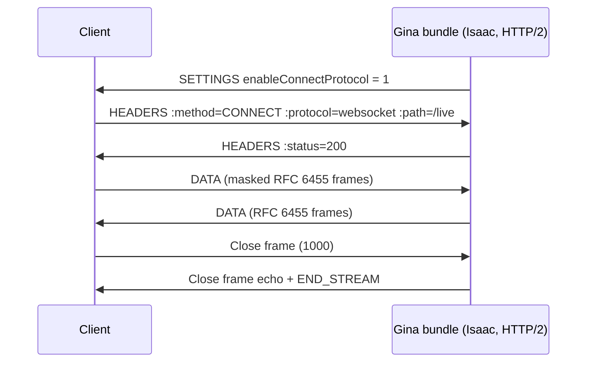

# WebSocket over HTTP/2

Since `0.4.7`, Gina's Isaac engine can serve WebSocket endpoints over
**HTTP/2 extended CONNECT** (RFC 8441). The WebSocket rides an HTTP/2 stream on
the connection the browser already holds — no second TCP connection, no
HTTP/1.1 `Upgrade` dance, no external WebSocket library: the RFC 6455 framing
codec is built into the framework. Since `0.5.5` you can also declare endpoints
straight in `routing.json` and call other bundles from a handler with
`session.query()`.



## Requirements

- A bundle running the **`http/2.0` protocol** — `https` or cleartext h2c
  (`"scheme": "http"`, e.g. behind a TLS-terminating reverse proxy) alike.
- The opt-in flag in `settings.json` — strictly the boolean `true`:

```json title="src/<bundle>/config/settings.json"
{
  "server": {
    "protocol": "http/2.0",
    "scheme": "https",
    "http2Options": {
      "enableConnectProtocol": true
    }
  }
}
```

With the flag off (the default) nothing changes: the server never advertises
the extended-CONNECT capability and behaves byte-identically to previous
releases.

## Registering a handler

Register WebSocket endpoints from your bundle's `onInitialize` — the `app`
argument is the raw server object:

```js title="src/<bundle>/index.js"
demo.onInitialize(function(event, app, express) {

    app.onWebSocket('/live', function(session, request) {

        session
            .onMessage(function(data, isBinary) {
                // text arrives as a UTF-8 string, binary as a Buffer
                session.send('echo: ' + data);
            })
            .onClose(function(code, reason) {
                console.log('client left', code, reason);
            });

        session.send('welcome');
    });

    event.emit('complete', app);
});
```

- Paths match the request's `:path` with the query string stripped. A plain
  path matches **exactly**; a path with a `:name` segment — e.g. `/live/:room`,
  since `0.5.5` — matches any non-empty segment and exposes the captured value
  on `request.params.room`. A name follows the
  [routing grammar](/guides/routing#parameterized-url), letters, digits and
  underscores: since `0.7.13` `/live/:lang-code` exposes `request.params.lang`,
  holding the whole segment, as an HTTP route reads it, and a segment with no
  name after its `:`, or with two or more placeholders, is compared as written.
  An exact path always wins over a `:param` pattern,
  and among overlapping patterns the first registered wins. An extended-CONNECT
  request for an unregistered path is refused with `404`.
- The handler receives the live `session` plus the original `request`, whose
  headers carry everything sent with the handshake (`cookie`,
  `sec-websocket-protocol`, your own headers).
- Calling `onWebSocket` on a bundle without HTTP/2 + the flag logs a warning
  and does nothing — safe across differently-configured environments.
- Like all `onInitialize` wiring, registrations are load-once: **restart the
  bundle to apply changes.**

## Declarative routes in `routing.json`

Since `0.5.5`, you can declare a WebSocket endpoint in `routing.json` instead of
calling `app.onWebSocket()` by hand. Give the route `"method": "ws"` and point
`param.wsHandler` at a handler module in your bundle's `channels/` directory —
the framework registers it automatically at bundle start:

```json title="src/<bundle>/config/routing.json"
{
  "live-feed": {
    "url":    "/live/:room",
    "method": "ws",
    "param":  {
      "wsHandler": "feed",
      "wsOptions": { "protocol": "chat", "maxPayload": 65536 }
    }
  }
}
```

```js title="src/<bundle>/channels/feed.js"
module.exports = function(session, request) {
    var room = request.params.room;          // the ":room" capture
    session.onMessage(function(data) {
        session.send('[' + room + '] ' + data);
    });
};
```

- The handler module is a plain `module.exports = function(session, request) {}`
  — **not** a controller. It has no render lifecycle and lives for the whole
  connection. It can use the framework lib registry (`require('lib/<name>')`),
  the ORM (`getModel('<bundle>', '<Model>')`), and `session.query()` (below).
- `param.wsOptions` is optional and accepts any subset of `maxPayload`,
  `protocol`, `closeTimeout`, `autoPong` and `maxPendingAutoPongs` (see
  [Session limits](#session-limits)), applied when the connection is accepted.
  `app.onWebSocket()` takes the same object as its third argument.
- `:param` segments, exact-over-param precedence, and first-registered-wins
  ordering work exactly as for the programmatic API above.
- A missing or unloadable `channels/<name>.js`, or a `ws` route without
  `param.wsHandler`, fails the bundle boot loudly — the error surfaces at deploy
  time, not at first connect.
- A programmatic `app.onWebSocket()` for the same path overrides a declared one
  (last write wins). Declared routes need the same Isaac + `enableConnectProtocol`
  prerequisites; on any other engine the registration warns and is skipped.

## The session API

| Member | Behaviour |
|---|---|
| `send(data)` | `string` → TEXT frame, `Buffer` → BINARY frame. Returns `false` when the stream signalled backpressure — pause until `onDrain` fires. |
| `ping(payload)` | Sends a PING (≤ 125 bytes). Inbound PINGs are answered automatically, within the [session limits](#session-limits). |
| `close(code, reason)` | Starts the close handshake; if the peer does not answer within the close timeout (`closeTimeout`, 5 s), the stream is reset and any data still queued on it is dropped. |
| `onMessage(fn)` | `(data, isBinary)` — text is UTF-8-validated before delivery. |
| `onPing(fn)` / `onPong(fn)` | Control-frame visibility (the pong reply is already handled). |
| `onClose(fn)` | `(code, reason)` — the single **terminal** event, delivered exactly once: peer close, protocol failure, or transport loss (`1006`). |
| `onError(fn)` | Diagnostic, with `err.closeCode`; always followed by `onClose`. |
| `onDrain(fn)` | Backpressure relief, forwarded from the underlying stream. |
| `isClosed()` | Whether the terminal close has been delivered. |
| `query(options[, data])` | _(since `0.5.5`)_ Calls another bundle over HTTP and returns a Promise (with an optional trailing callback) — see [Cross-bundle calls](#cross-bundle-calls). |

Protocol violations (bad framing, an unmasked client frame, invalid UTF-8,
oversized messages) are answered with the RFC 6455 status code (`1002`,
`1007`, `1009`, …) and the session is torn down — your handler only ever sees
clean messages. A **throwing handler** is contained too: the session closes
with `1011` instead of crashing the bundle. Reassembled messages are capped
at 1 MiB and 100 fragments.

## Session limits

| Option | Default | Behaviour |
|---|---|---|
| `closeTimeout` | `5000` (ms) | How long a session waits for the peer's Close frame after `session.close()`. Past it, the stream is reset and any data still queued on it is dropped (since `0.7.12`; before, the stream was half-closed). |
| `autoPong` | `true` | Answer inbound PINGs automatically. With `false` the session leaves them unanswered; `onPing` still sees them. |
| `maxPendingAutoPongs` | `60` | _(since `0.7.12`)_ Automatic Pongs that may wait to be written. One more PING closes the session with `1006` and resets the stream. `0` removes the bound. |

Pass them in `param.wsOptions`, or as `app.onWebSocket()`'s third argument.

- A session answers no PING after it has sent its own Close frame.
- The bound counts the Pongs the stream has not finished writing, so a client
  that reads can reach it too when more than 60 PINGs arrive at once. Raise
  `maxPendingAutoPongs` for such a client.
- To send a large last message, check what `send()` returns: when it is
  `false`, wait for `onDrain` before you call `close()`, or raise
  `closeTimeout`. Data still queued when the close timeout resets the stream
  is dropped.

## Cross-bundle calls

Since `0.5.5`, a channel handler can call another bundle over HTTP with
`session.query()` — the same cross-bundle call a controller makes with
`self.query()`, reusing the running server's warm HTTP/2 session cache:

```js
app.onWebSocket('/live', async function(session, request) {
    var res = await session.query({ hostname: 'api@myproject/dev', path: '/rooms/42' });
    session.send(JSON.stringify(res));
});
```

It returns a Promise (with an optional trailing `(err, data)` callback) and
resolves the target bundle by hostname. Same-bundle data access still goes
through `getModel()` directly; `session.query()` adds the inter-bundle HTTP leg
`getModel()` cannot do. Requires the Isaac engine with
`http2Options.enableConnectProtocol` set to `true`.

## Authentication

No middleware runs on the CONNECT path — sessions, CSRF, and other
`app.use` plugins never see the handshake. Authenticate **inside the
handler** from the request it receives, and close unauthenticated sessions
immediately:

```js
app.onWebSocket('/live', function(session, request) {
    if (!isAuthorized(request.headers['cookie'])) {
        session.close(1008, 'policy violation');
        return;
    }
    // ...
});
```

## Lifecycle and shutdown

- Inbound PINGs are answered automatically, within the
  [session limits](#session-limits); send your own `session.ping()` as a
  heartbeat when you need liveness detection.
- On bundle shutdown (`SIGTERM`), live sessions are closed gracefully with
  `1001 going away` before the server drains.
- HTTP/2 stream or session loss (network drop, `GOAWAY`) surfaces as
  `onClose(1006)`.

## Limitations

- **HTTP/2 only.** A client that does not negotiate HTTP/2 falls back to the
  classic HTTP/1.1 `Upgrade` handshake, which `onWebSocket` does not serve.
  Since `0.7.12` such a request is answered as a plain HTTP request (Node.js
  22.21 and later, 24.9 and later, when no other upgrade listener is attached)
  or closed after one second; on Bun, when another upgrade listener is
  attached, it is left to that listener.
  Browsers use extended CONNECT automatically when the page's origin
  connection is HTTP/2 and the server advertises the capability; for
  server-to-server use, pick a client that supports RFC 8441.
- **Isaac engine only** — the Express engine has no HTTP/2 stream seam.

## Observability

The `/_gina/info` endpoint's `http2` block reports an `extendedConnect`
counter — the number of extended-CONNECT streams the server has seen.
The per-session rapid-reset guard (`maxStreamResetsPerSecond`) is armed on WebSocket
streams too: a CONNECT stream the client resets before it is answered counts like any
other, so a CONNECT rapid-reset flood trips the same `GOAWAY` defense. Merely opening
many CONNECT streams does not — they are bounded by `maxConcurrentStreams`.
