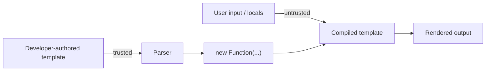

# Security

Swig compiles template source into executable JavaScript via `new Function(...)`. The attack surface is small but high-impact — the parser is the sandbox boundary, and any weakness in it is remote code execution.

This fork (`@rhinostone/swig`) exists partly so security fixes can land without waiting on upstream (which is abandoned).

## Security model

Swig treats **template source as trusted code** and **template context (locals) as untrusted data**. This is the same model as Django templates, Jinja2, Twig, and most server-side template engines.

### Consequences

- **Server-side template injection (SSTI) is game over.** If an attacker can inject arbitrary template source, they can call global functions (e.g. `{{ Function("return process")() }}`). This is not a vulnerability in Swig — it is a vulnerability in the application that allows user input into template source.
- **The `_dangerousProps` blocklist is defense-in-depth** against context-mediated prototype pollution. It prevents accidental abuse through `_ctx.__proto__` / `_ctx.constructor` paths, not targeted attacks by an author who already controls the source.
- **`new Function(...)` is the compilation mechanism, not a sandbox.** Compiled templates run with full access to JavaScript globals (`Function`, `Object`, `Array`, `Date`, `JSON`, …). Restricting those would break legitimate templates.

## Known advisories

### CVE-2021-44906 — `minimist` prototype pollution (transitive)

**Affected:** `swig@1.4.2` and earlier.

**Root cause:** `swig` depended on `optimist ~0.6`, which pinned `minimist ~0.0.1` — any `minimist < 1.2.6` is vulnerable to prototype pollution via `--__proto__.key value` argv. Reachable through `bin/swig.js`.

**Fixed in:** `@rhinostone/swig@1.4.5` — `optimist` was replaced with `yargs@3`, which has no `minimist` dependency. The vulnerable transitive edge no longer exists.

### CVE-2023-25345 — directory traversal / arbitrary file read {#cve-2023-25345}

**Affected:** `@rhinostone/swig` through `2.7.0` — and the shared `@rhinostone/swig-core` loader, so every flavor (Twig, Jinja2, Django). Inherited from upstream `swig ≤ 1.4.2`. CWE-22, CVSS 7.5 (`CVSS:3.1/AV:N/AC:L/PR:N/UI:N/S:U/C:H/I:N/A:N`).

**Root cause:** the filesystem loader's `resolve(to, from)` joined the requested path to the root without confining the result to it. An `` / `` / `` path that traversed upward (`../../../etc/passwd`) escaped the configured `basepath` and read an arbitrary file into the render. The genuinely dangerous form needs only untrusted **data**, not untrusted template source — `` where `userVar` comes from `locals`.

**Fixed in `2.7.1`:** with a `basepath` set, `resolve()` now rejects any path that resolves outside the root (a `path.sep`-anchored prefix check, so a `/views-secret` sibling cannot bypass `/views`). **`2.7.2`** then resolved the `basepath` to an absolute path before the check, so a *relative* basepath works — `2.7.1` wrongly rejected every in-root path when `basepath` was relative. Templates that intentionally read outside the root opt out with the third loader argument, [`swig.loaders.fs(basepath, encoding, allowOutsideRoot)`](./loaders#swigloadersfs). **Upgrade to `≥ 2.7.2`.** No-`basepath` mode is unconfined — the secure posture is to set a `basepath`.

### GHSA-86pr-x856-xrq5 — templates that include, import or extend themselves on the async render path {#ghsa-86pr-x856-xrq5}

**Affected:** `@rhinostone/swig`, `@rhinostone/swig-core` and `@rhinostone/swig-twig` from `2.2.0`, `@rhinostone/swig-jinja2` from `2.5.0` and `@rhinostone/swig-django` from `2.7.0`, each before `2.9.5`. High, CWE-674 and CWE-400, CVSS 7.5 (`CVSS:3.1/AV:N/AC:L/PR:N/UI:N/S:U/C:N/I:N/A:H`).

**Root cause:** on the [async render path](./loaders#async-loaders) (`renderFile(path, locals, cb)` with a loader that sets `loader.async`, or `compileFile` with `codegenMode: 'async'`) nothing limited how deeply templates could nest. A template that includes, imports or extends itself, directly or through other templates, therefore loaded templates until the heap ran out and the process aborted; under a 64 MB heap `2.9.4` aborted after 11 to 14 seconds. Reaching it from a request takes an application that puts request data into an include or extends path; a template mistake reaches it without any. The sync render path ends these renders and was not affected.

**Fixed in `2.9.5`:** each top-level async render counts the templates it has in progress, and loading a template while 1000 are in progress fails the render with an error that names it; an extends cycle fails at once with the sync path's `Illegal circular extends` error. See [Async loaders](./loaders#async-loaders) and the [advisory](https://github.com/gina-io/swig/security/advisories/GHSA-86pr-x856-xrq5).

### GHSA-g628-5x3r-g298 — a nested block override shown on other pages through the compile cache {#ghsa-g628-5x3r-g298}

**Affected:** every release of `@rhinostone/swig`, `@rhinostone/swig-core`, `@rhinostone/swig-twig`, `@rhinostone/swig-jinja2` and `@rhinostone/swig-django` before `2.9.5`; the code dates from the original swig 1.4.2. Medium, CWE-668, CVSS 6.5 (`CVSS:3.1/AV:N/AC:L/PR:N/UI:N/S:U/C:L/I:L/A:N`).

**Root cause:** with the default memory cache, a page that extends a layout used the layout's cached parse tree as its parent, and the block remap rewrote that cached tree. Once the layout was in the compile cache (compiled, rendered or included on its own), or the middle template of a three-level chain had been rendered as a page, the first page that overrode a block nested inside another block or tag (an `if`, a `for` loop) put its block into the cached layout, and every page compiled later that did not override that block rendered it until the cache was cleared. The leaked block renders with the data of the page that shows it; what leaks is template content written for another page, such as a block only administrators should see. In native swig the same shared parent made `` in a middle template that was in the compile cache render that template's block twice.

**Fixed in `2.9.5`:** a parent taken from the compile cache is copied before its blocks are remapped, and the copy carries the parent's file name. See [Cache keys](./loaders#cache-keys) and the [advisory](https://github.com/gina-io/swig/security/advisories/GHSA-g628-5x3r-g298).

### GHSA-f8f4-95q3-38qw — array size from template data in ranges, `batch` and `slice` {#ghsa-f8f4-95q3-38qw}

**Affected:** `@rhinostone/swig-twig` from `2.0.0-alpha.3`, `@rhinostone/swig-jinja2` from `2.5.0` and `@rhinostone/swig-core` from `2.0.0-alpha.5`, each before `2.9.2`. High, CWE-789 and CWE-835, CVSS 7.5 (`CVSS:3.1/AV:N/AC:L/PR:N/UI:N/S:U/C:N/I:N/A:H`).

**Root cause:** a swig-twig range `a..b`, the padding of `batch` (swig-twig and swig-jinja2) and the columns of swig-jinja2 `slice` built an array whose length came from a number in the data, so a large number exhausted the heap and aborted the process; under a 256 MB heap `1e8` (a `slice` count of `1e7`) did so within a second. A range whose values reach 2^53 never ended, since adding 1 no longer changes a JavaScript number. Reaching any of these takes an application that passes request data into the bound, the size or the count. Native swig and swig-django have none of these features.

**Fixed in `2.9.2`:** a range of more than 1,000,000 elements is empty, as for an infinite bound; `slice` with more than 1,000,000 columns returns an empty list; `batch` leaves the last chunk unpadded for a size above 1,000,000. See the [advisory](https://github.com/gina-io/swig/security/advisories/GHSA-f8f4-95q3-38qw).

### GHSA-rvx7-jqr9-c242 — quadratic-time regular expressions in `striptags`, `trim` and other filters {#ghsa-rvx7-jqr9-c242}

**Affected:** `@rhinostone/swig` before `2.9.1` (`striptags`, every release), `@rhinostone/swig-twig` from `2.0.0-alpha.3`, `@rhinostone/swig-jinja2` from `2.5.0` and `@rhinostone/swig-django` from `2.7.0`, each before `2.9.1`. High, CWE-1333, CVSS 7.5 (`CVSS:3.1/AV:N/AC:L/PR:N/UI:N/S:U/C:N/I:N/A:H`).

**Root cause:** several filters used regular expressions that take time quadratic in the length of their input on some inputs: `striptags` in every flavor on text with many `<` and no `>` after them, `trim` in swig-twig and swig-jinja2 on a long run of the trimmed characters inside the text, swig-jinja2 `format` on a `%` followed by a long run of zeros, and swig-django `truncatewords`, `pluralize`, `slugify` and `floatformat`. On 100 000 characters each blocked the event loop for seconds. Reaching one takes an application that applies the filter to request data.

**Fixed in `2.9.1`:** the filters run in linear time with the same output. See the [advisory](https://github.com/gina-io/swig/security/advisories/GHSA-rvx7-jqr9-c242).

### GHSA-q89c-947c-m7xr — code execution through the template filename {#ghsa-q89c-947c-m7xr}

**Affected:** all five packages before `2.8.3`, including the 1.x line. Critical, CWE-94, CVSS 9.8 (`CVSS:3.1/AV:N/AC:L/PR:N/UI:N/S:U/C:H/I:H/A:H`).

**Root cause:** the code generator wrote the template filename into a double-quoted string literal in the compiled function body without escaping it: the `filename` option of `render`, `compile` and `precompile`, or the resolved path that `renderFile` and `compileFile` use. A double quote in that value ended the literal, and the rest ran as JavaScript whenever the template rendered. Reaching it takes an application that passes request data as the `filename` option.

**Fixed in `2.8.3`:** the code generator escapes the filename wherever it writes it. `2.8.4` also compiles a filename that is not a string, such as a number, which `2.8.3` rejected. If you cannot upgrade, pass only a server-controlled string as `filename`. See the [advisory](https://github.com/gina-io/swig/security/advisories/GHSA-q89c-947c-m7xr).

### GHSA-48rg-vg49-r5vm — unbounded loops in `wordwrap` and ranges {#ghsa-48rg-vg49-r5vm}

**Affected:** `@rhinostone/swig-jinja2` before `2.8.2`, and `@rhinostone/swig-twig` and `@rhinostone/swig-core` from `2.0.0-alpha.5` before `2.8.2`. High, CWE-835, CVSS 7.5 (`CVSS:3.1/AV:N/AC:L/PR:N/UI:N/S:U/C:N/I:N/A:H`).

**Root cause:** swig-jinja2 `wordwrap` with a width below 1, and a swig-twig range `a..b` with an infinite bound (plain JSON yields `Infinity` for a number such as `1e999`), looped for seconds and took more than 2 GB of memory before failing. Reaching either takes an application that passes request data into the width or the bound. Native swig has neither the filter nor the operator.

**Fixed in `2.8.2`:** a width of 0 or less returns the text unchanged and a width between 0 and 1 breaks one character at a time; a range with an infinite bound is empty. See the [advisory](https://github.com/gina-io/swig/security/advisories/GHSA-48rg-vg49-r5vm).

## Prototype-chain hardening (`__proto__` / `constructor` / `prototype`) {#prototype-chain-hardening}

Independently of the CVE above, Swig blocks template expressions from reaching the prototype chain through `_ctx` access. *(Earlier releases of this fork tracked this hardening under the CVE-2023-25345 label; that was a mislabel — the authoritative CVE-2023-25345 is the file-read traversal documented above. The guards below are real defense-in-depth, not that CVE. Until `2.8.2` their error messages also ended with `(CVE-2023-25345)`; they now end with `(prototype-chain guard)`.)*

**Root cause it addresses:** template source that reaches the prototype chain through `_ctx` access (`__proto__`, `constructor`, `prototype`) can escape into the surrounding JavaScript runtime. The canonical exploit is `{{ constructor.constructor("return process")() }}` — the lexer emits a single VAR token, the parser generates `_ctx.constructor.constructor` (which is `Function`), and the template then calls it with arbitrary code.

**Added in two phases:**

| Phase | Version | Coverage |
| --- | --- | --- |
| Phase 1 | `1.4.4` | Dot-notation and direct-name access in `parseVar` + DOTKEY handler + `set` tag. |
| Phase 2 | `1.5.0` | Bracket-notation in variable output and `set`; reserved names blocked in `for` loop variables, `macro` names, and `import` aliases. |

### What the guards protect against

| Vector | Guard | Severity if unpatched |
| --- | --- | --- |
| `{{ __proto__ }}` / `{{ constructor }}` | `parseVar` `_dangerousProps` check | High — RCE via `constructor.constructor(...)` |
| `{{ foo.__proto__ }}` | DOTKEY `_dangerousProps` check | Medium — info leak, potential RCE via chaining |
| `{{ foo["__proto__"] }}` | STRING-in-BRACKETOPEN check | Medium — info leak |
| `` | `set.js` VAR handler | High — prototype pollution of `_ctx` |
| `` | `set.js` STRING handler | High — prototype pollution of `_ctx.foo` |
| `` | `for.js` VAR handler | High — per-iteration pollution of `_ctx` |
| `` | `macro.js` FUNCTION handler | Medium — overwrites `_ctx.__proto__` with a function |
| `` | `import.js` VAR handler | Medium — overwrites `_ctx.__proto__` with a namespace |

### What the guards do NOT protect against

| Vector | Why not | Risk |
| --- | --- | --- |
| `{{ foo[varname] }}` where `varname` resolves to `"__proto__"` at runtime | Would require a runtime wrapper and add overhead to every bracket access. | Low — info leak only, not RCE. |
| `{{ foo["__pr" + "oto__"] }}` | Result only known at runtime. | Low — same as above. |
| `{{ Function("return process")() }}` | Template source is trusted; globals are available by design. | N/A — SSTI is game over for any template engine. |
| `{{ eval("code") }}` | Same as above. | N/A — by design. |
| Prototype pollution via a locals object with an own `__proto__` property | `for…in` + `hasOwnProperty` iterates own properties; JSON-parsed objects can carry `__proto__` as own property. | Low — only affects that template's `_ctx`; does not pollute `Object.prototype`. |

## General hardening guidelines

### The parser is the boundary

Everything that reaches `new Function(body)` becomes trusted JavaScript. Two rules for anyone touching the emitted source:

- **String tokens are JSON-escaped** into `_output += "…";`. Do not weaken this escaping. The escape chain is `.replace(/\\/g, '\\\\').replace(/\n|\r/g, '\\n').replace(/"/g, '\\"')`.
- **Identifiers from user input must never reach emitted source verbatim.** Confine them to `_ctx.<ident>` lookups (`<ident>` is already a lexer-validated VAR token) or `JSON.stringify` them.

### Tags that write to `_ctx.*` must validate identifiers

Any tag whose `compile` emits `_ctx.<name> = …` must check `<name>` against `_dangerousProps` in its `parse` handler. Built-ins that do this:

- `set` — checks VAR, DOTKEY, and STRING (in bracket position).
- `for` — checks VAR tokens (loop variable + key).
- `macro` — checks FUNCTION / FUNCTIONEMPTY tokens (macro name).
- `import` — checks VAR tokens (alias name).

New tags that assign to `_ctx.*` **must include the same guard**. Copy the pattern from [`for.js`](https://github.com/gina-io/swig/blob/develop/lib/tags/for.js) (simplest example).

### Tags that swallow tokens bypass `parseVar`

When a tag calls `parser.on(types.VAR, fn)` and the callback returns falsy, the default `parseVar` handler never runs — any check inside `parseVar` is invisible to that tag. Tags that do this: `set`, `for`, `import`, `macro`. Each has its own copy of the `_dangerousProps` check. If you add a new guard in `parseVar`, audit every tag that intercepts tokens — they need their own copy.

### `swig run` is not a sandbox

[`swig run`](./cli) literally calls `eval(str)` on the generated template source. Never pass untrusted template input to `swig run`. It is a developer tool for round-tripping pre-compiled templates, not a rendering primitive.

### Autoescape is the only default XSS protection

With `autoescape: true` — the library's default; a gina bundle sets it with [`settings.swig.autoescape`](/reference/settings#swig), which is `false` until 0.8.0 — every `{{ … }}` is piped through the `e` filter automatically. A filter **wrongly** marked `.safe = true` bypasses this — double-check any new `.safe` annotation.

On gina installed with npm, 0.5.25 to 0.7.0 silently ignored a bundle's `autoescape: true`; it is applied since 0.7.1 (see the [migration guide](/migration#070--071)).

Shipping `.safe`: `safe`, `raw`, `json` / `json_encode` (which self-escape `<`, `>`, `&`, `'` before bypassing autoescape), and `url_encode`. `escape` / `e` are **not** flagged — an explicit `{{ x|e }}` avoids double-escaping because the HTML escape is idempotent, not because the autoescape pass is suppressed. `url_decode` is deliberately **not** `.safe` — decoded content can be arbitrary HTML, so its output stays autoescaped. Per-filter table: [Filters](./filters).

`autoescape: false` disables escaping globally. Any consumer setting this is asserting they control template source entirely.

### `cache: 'memory'` is not a trust boundary

The in-memory cache is keyed by the loader's resolved filename. Templates compiled for one user's context can be served to another user if the cache key collides — this is a feature (cross-request template reuse) but it means:

- Do not include per-request secrets in the loader's `resolve()` output.
- Do not bake per-user data into `precompile` output — keep per-request data in the `locals` context, which is re-bound on every render.

## `eval` / `new Function` inventory

Full dynamic-code-execution surface:

| Location | Usage | Risk |
| --- | --- | --- |
| `@rhinostone/swig-core` `lib/engine.js` | `new Function('_swig','_ctx','_filters','_utils','_fn', body)`; on the async-codegen path, `new AsyncFunction('_swig','_ctx','_filters','_utils','_fn','_blocks', body)` | By design. `body` is built by the parser from the parsed token tree. |
| `bin/swig.js` (`swig run`) | `eval(str)` | Developer tool. `str` is the pre-compiled template file. |
| `bin/swig.js` (`swig run`) | `eval(argv['method-name'])` | Evaluates the method name from `--method-name`. If an attacker controls CLI args, they already have shell access. |

No other `eval`, `new Function` or `AsyncFunction` construction exists in the published packages.

## Reporting

Report security issues privately, as [SECURITY.md](https://github.com/gina-io/swig/blob/develop/SECURITY.md) describes: through GitHub's [private vulnerability reporting](https://github.com/gina-io/swig/security/advisories/new), not a public issue or pull request. Upstream (`paularmstrong/swig`) is unmaintained and should not be treated as a reporting channel.

